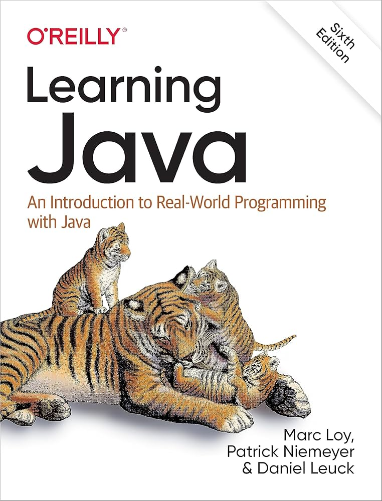
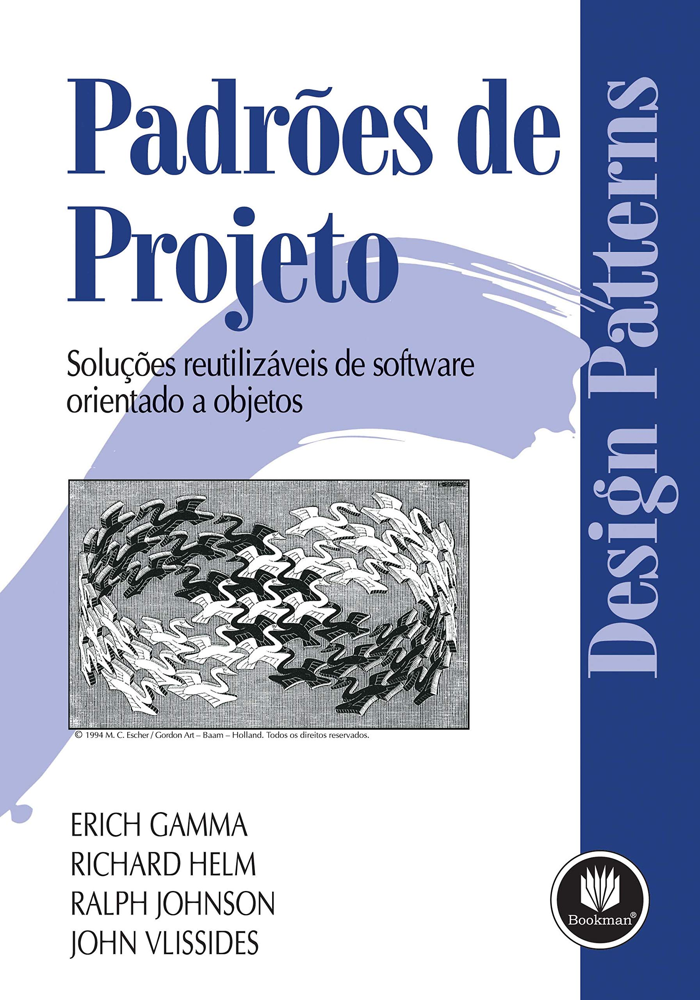
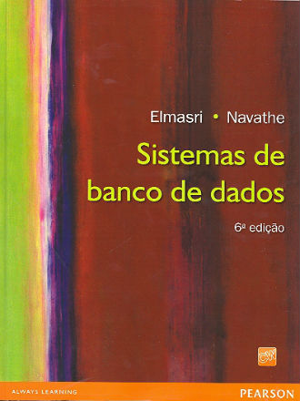

<!-- cabeçalho -->

 

<!-- breve descrição -->

Graduando em <b>Engenharia de Software pela PUC Minas</b>, com foco no desenvolvimento de soluções que resolvem problemas reais e geram valor para clientes. Interesse em transformar necessidades do mundo real em sistemas eficientes, escaláveis e bem estruturados, aplicando boas práticas de engenharia e programação.

---

## 🚀 Sobre Mim

> 💻 Atuação em projetos **full stack**, com domínio em Java, JavaScript, C/C++ e frameworks como Spring Boot e React.js.
>
> 🔧 Experiência em desenvolvimento de **APIs REST**, integração com bancos de dados SQL e boas práticas de versionamento com Git.
>
> 💡 Interessado em projetos que trazem impacto real e resolvem problemas do cotidiano.
>
> 🌱 Em constante aprendizado e evolução, buscando aplicar soluções tecnológicas a problemas reais e complexos.

---

## 🖥 Tecnologias

| Categoria | Stack |
| :---: | :--- |
| **🧠 Linguagens** |  |
| **🎨 Front-end** |  |
| **⚙️ Back-end** |  |
| **🗄️ Banco de dados** |  |
| **🛠️ Ferramentas & DevOps** |  |

---

## ⏱ Minhas métricas

⌚ <a href="https://wakatime.com/@joaquim_antonio">WakaTime</a>

  

---

## 📖 Leituras recentes

 

---

## ☎ Contato

 

<!-- footer -->

