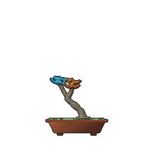
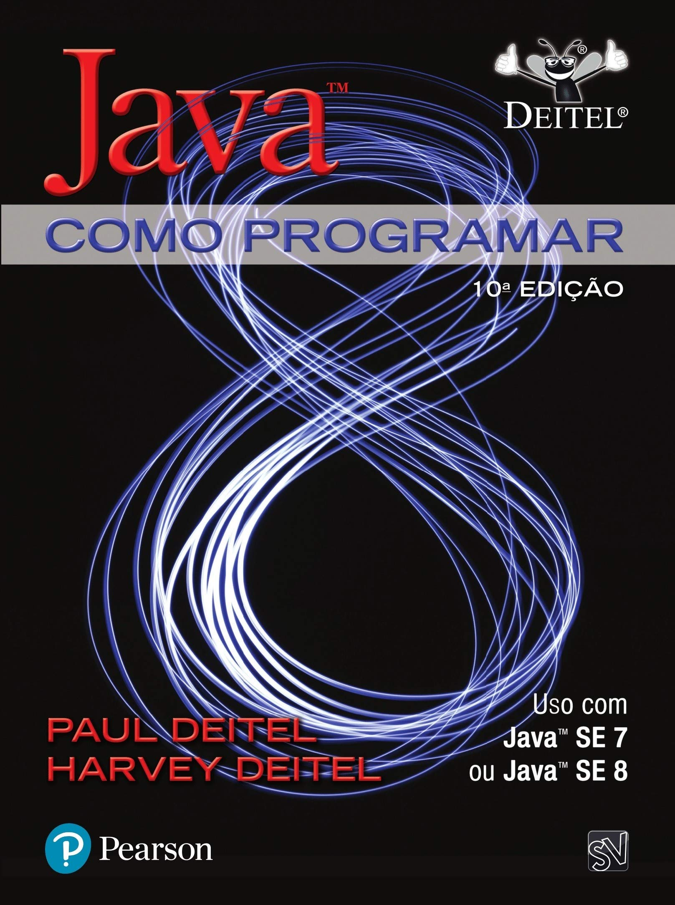

<!-- CABEÇALHO -->

  

<h1 align="center">Olá, eu sou o Joaquim Antonio! </h1>

  <strong>Engenheiro de Software</strong> &nbsp;·&nbsp; Graduando na PUC Minas

  

📬 Me liga hein!

  

  
  
  
  

<!-- SOBRE -->

Sou estudante de Engenharia de Software na PUC Minas e desenvolvedor com interesse em criar soluções úteis, escaláveis e bem estruturadas. Gosto de conectar necessidades reais a sistemas que entregam valor, com atenção à arquitetura, à qualidade do código e à experiência de uso.

<!-- TECNOLOGIAS -->
🧩 Tecnologias e ferramentas

<table align="center">
  <tr>
    <td align="center" width="50%">
       
      
    </td>
    <td align="center" width="50%">
       
      
    </td>
  </tr>
  <tr>
    <td align="center" width="50%">
       
      
    </td>
    <td align="center" width="50%">
       
      
    </td>
  </tr>
  <tr>
    <td align="center" colspan="2">
       
      
    </td>
  </tr>
</table>

<!-- ATIVIDADE -->
📈 Minhas métricas

<table align="center">
  <tr>
    <td width="50%" align="center">
      
    </td>
    <td width="50%" align="center">
      
    </td>
  </tr>
</table>

<!-- BONSAI -->
🌳 Meu bonsai de contribuições

  <em>Uma representação em pixel art da minha trajetória no GitHub: a árvore acompanha meu histórico de contribuições.</em>

  

  Gerado pelo <a href="https://github.com/egorthinks/git-bonsai">git-bonsai</a> · Atualizado automaticamente pelo GitHub Actions

<!-- LEITURAS -->
📚 Minha estante: livros mais recentes, tanto técnicos quanto literários

  
  
  
  
  

<!-- FOOTER -->

